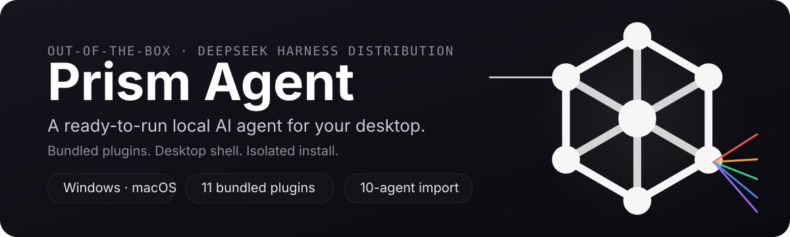
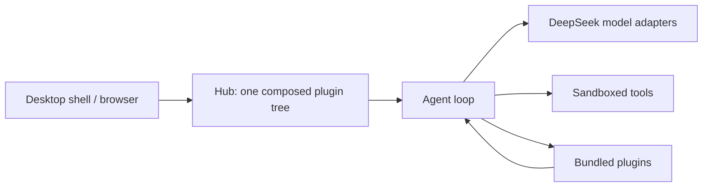

# Prism Agent

English | [中文](README.zh.md)

<p align="center">
  
</p>

<p align="center">
  <a href="https://github.com/deepseek-ai/deepseek-harness"></a>
  <a href="LICENSE"></a>
  <a href="https://nodejs.org"></a>
  <a href="https://github.com/laochenfei233/prism-agent/releases"></a>
</p>

**Prism Agent** is an out-of-the-box distribution of [DeepSeek Harness](https://github.com/deepseek-ai/deepseek-harness) (`dsh`), the everything-is-a-plugin agent harness built on [Cordis](https://github.com/cordiverse/cordis): the harness stays the engine, and Prism turns it into a finished product — a native desktop shell, a curated set of plugins preinstalled and wired on first launch, and an install identity isolated from every other harness build on the machine.

## Why Prism Agent

- **Ready on first launch.** The installer bundles the Node runtime, the full web UI, and eleven plugins — conversation import, transfer, backup, memory, meetings, chat bots, guardrails, and more — so the first conversation needs an API key and nothing else.
- **Fast to return to.** The desktop shell records the hub it spawned and re-adopts it on the next start, skipping the full ~4.1 s boot, and the boot resolver lists each search directory once instead of probing every path (measured cold start on the packaged runtime: 4269 ms → 3903 ms).
- **Finishes more of its tasks.** Long turns stay healthy: stale tool results are cleared before compaction, repeated failures hand a one-shot judge that nudges the model instead of stalling, durable memory carries verified facts across sessions, and long delegations expose job controls (`job_list` / `job_kill`) plus scheduled follow-ups.
- **Local-first desktop.** A Tauri 2 shell with tray residency, single-instance launches, crash auto-restart, in-app updates from GitHub Releases, folder drag-and-drop, and a loopback session proxy that keeps the sign-in alive across port changes.
- **Isolated by design.** The `prism` command, the `prism-agent` package name, the `~/.prism` home, private default ports, and a dedicated app bundle id mean an official `dsh`, another fork, or another Prism build can share the machine without collision.

<a id="run"></a>

## Quick start

### Desktop app

1. Download the installer for your platform from [GitHub Releases](https://github.com/laochenfei233/prism-agent/releases): a Windows NSIS installer, or a macOS dmg (unsigned — the release notes describe allowing it in System Settings).
2. Launch Prism Agent, open the Models settings page, and add your DeepSeek API key.
3. Start a conversation — the agent runs on your machine, with terminal, file, and web tools available out of the box.

The shell keeps serving the hub while the window is closed (tray resident) and restarts the service automatically if it crashes.

<a id="run-from-source"></a>

### Web UI from source

Prerequisites: Node.js ≥ 24.9 and pnpm ≥ 11.

```sh
git clone https://github.com/laochenfei233/prism-agent.git
cd prism-agent
pnpm install
pnpm run build
pnpm dsh web
```

<!-- PRISM-DIVERGENCE: replay list in docs/compose/spec/fork-upstream-divergence.md (S2), area A8. Upstream's CLI is `npx @deepseek-ai/dsh`; this fork installs its own `prism-agent` package so the two never collide on npm or `~/.dsh`. -->
This starts the Web UI at `http://127.0.0.1:3080` and opens it in the default browser; pass `--no-open` to skip that. `pnpm dsh` runs the CLI from source — the installed product command is `prism`, and this fork publishes no npm package, so upstream's `npx @deepseek-ai/dsh` line does not apply here.

## Safety

Review the [safety notice](SAFETY.md) before running the project.

## What's in the box

| Capability | What you get |
| --- | --- |
| Conversation import | Bring existing conversations from ten coding agents into the session list: Claude Code, Codex, Grok, DeepSeek Harness, MiMo Code, OpenCode, OpenClaw, Hermes, Pi, and Gemini CLI. |
| Export, migrate, back up | Export projects (folder + sessions + media) and settings as self-describing archives and import them back; scheduled backups to WebDAV, SMB, or S3. |
| Auditable memory | Durable, auditable memory: supersede chains, evidence fingerprints, `/memory verify` · `compare` · `maintain`, and model-assisted distillation. |
| Meetings and voice | Meeting transcription and minutes on the meetings page; local SenseVoice and online recognizers (MiMo, DashScope, and nine HTTP wire forms) with segmented long-audio transcription. |
| Local models | Run local models on your own machine from the Models page. |
| Remote access and bots | The Pocket mobile page plus nine chat channels (Telegram, Discord, Slack, Feishu/Lark, DingTalk, QQ, WeCom, WeChat, WhatsApp) with pairing-code binding and an approval relay. |
| Task reliability | Guardrails for context hygiene and stuck-session nudges; job controls for delegated subagents; scheduled follow-ups. |
| Housekeeping | Idle conversations auto-archive on a schedule and restore from Settings; the About page carries in-app updates. |
| Desktop pet bridge | HachimoDock lists Prism sessions, opens them, and steers the running agent. |

## How it works

Prism boots one hub per harness home: a plugin tree composed at startup from ordered bundles and patch layers, exactly as upstream `dsh` does. The agent loop inside it runs the turn lifecycle — assemble prompt sections and tool schemas, stream from the model, execute tools, append every model-visible fact to the durable session log — and the bundled plugins attach to that loop as ordinary event listeners, which is why they ship preinstalled yet stay patchable or removable from configuration.



The desktop shell spawns or adopts that hub, the browser UI talks to it over RPC and streams, and plugins both observe the loop (guardrails, memory, progress) and steer it (bot follow-ups, nudges, scheduled prompts). The full architecture, event domains, and extension points are documented in [docs/architecture.md](docs/architecture.md).

## Configuration

Every settings page writes a validated config row, and the generated [config catalog](docs/config-catalog.md) documents all of them; composition-level control — bundles, patches, out-of-tree plugins — stays in YAML as described by [the architecture guide](docs/architecture.md).

## For developers

- **Layout.** Every capability is a workspace package under `packages/<group>/<pkg>`, and shipped add-ons live in `plugins/`; the [package index](packages/README.md) maps the groups.
- **Dev loop.** `pnpm run dev:web` builds, serves, and rebuilds client bundles on source edits; the [development guide](docs/development.md) owns the full command table, and [AGENTS.md](AGENTS.md) is the entry point for agents.
- **Checks.** `pnpm run test`, `pnpm run test:coverage` (the per-file 100% coverage gate), `pnpm run typecheck`, and `pnpm run lint`.
- **Upstream sync.** This fork imports upstream as a baseline instead of merging it: every divergent site carries a `PRISM-DIVERGENCE` marker indexed in [docs/compose/spec/fork-upstream-divergence.md](docs/compose/spec/fork-upstream-divergence.md), and each resync replays the upstream delta through a recorded anchor tag.

## Acknowledgments

Prism Agent is built on [DeepSeek Harness](https://github.com/deepseek-ai/deepseek-harness) by [DeepSeek AI](https://deepseek.com); the harness design is described in [_A Programming Paradigm for Spatiotemporal Composability_](https://arxiv.org/abs/2608.25512). Upstream documentation lives at [deepseek-harness.github.io](https://deepseek-harness.github.io/deepseek-harness/), and upstream community links (Discussions, Discord, the `dsh-plugin` topic) are listed in [the upstream README](https://github.com/deepseek-ai/deepseek-harness#community-and-support).

## Citation

```bibtex
@misc{deepseek-harness2026,
  title={DeepSeek Harness: Everything is a Plugin},
  author={DeepSeek-AI},
  year={2026},
  publisher={GitHub},
  howpublished={\url{https://github.com/deepseek-ai/deepseek-harness}},
}
```

## License

[MIT](LICENSE) — third-party dependencies and their licenses are disclosed in [THIRD_PARTY_NOTICES.md](THIRD_PARTY_NOTICES.md).
