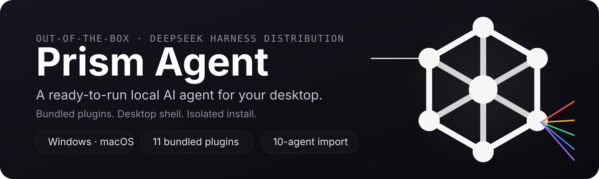
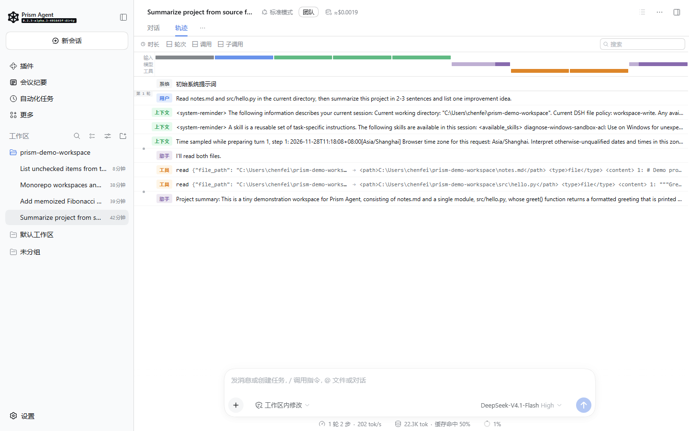
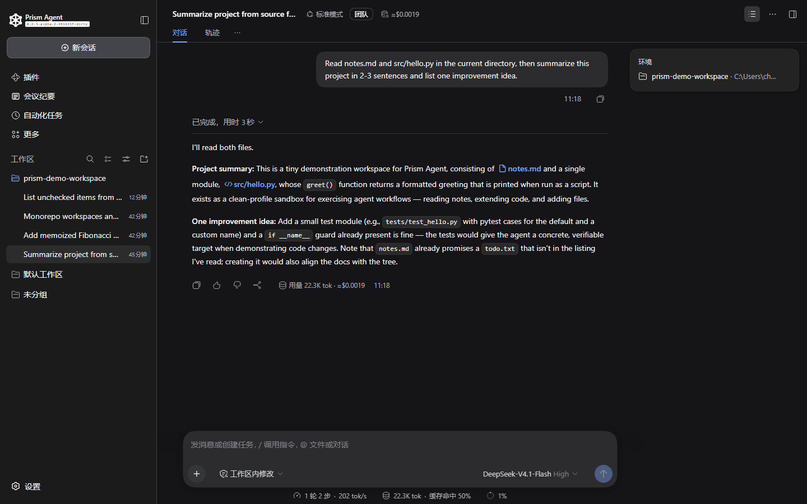
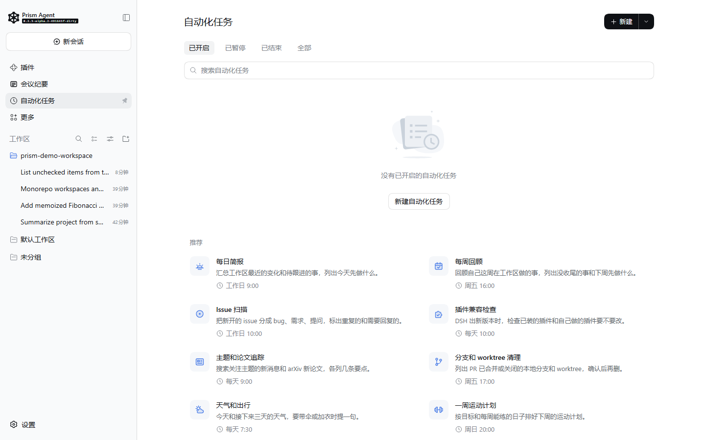
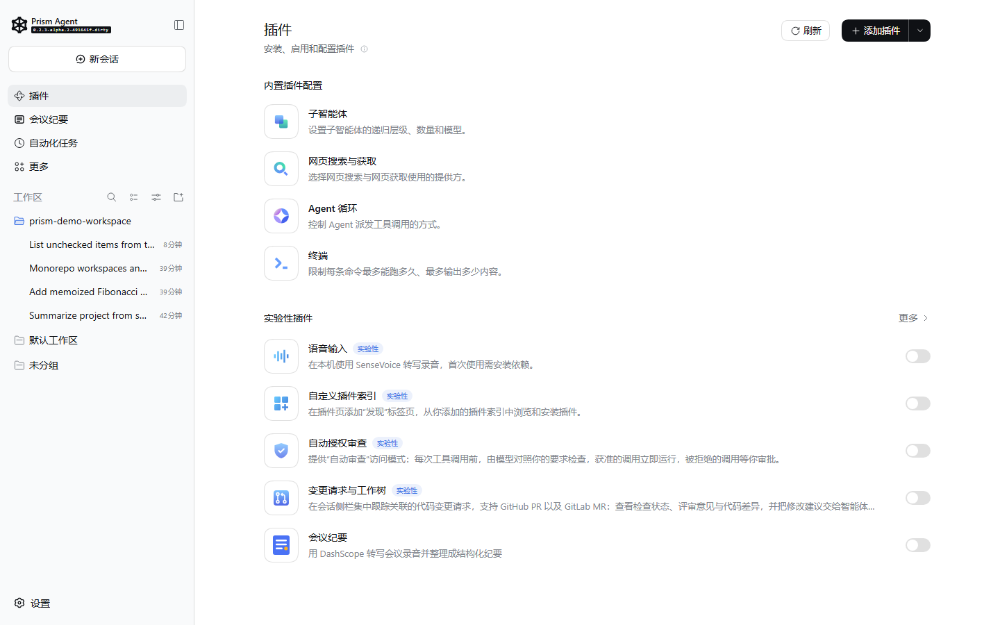
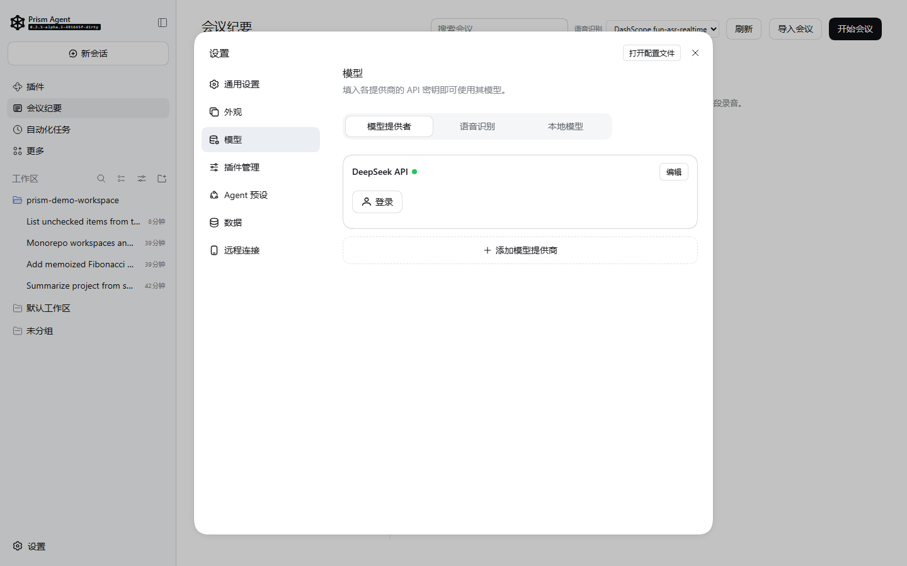
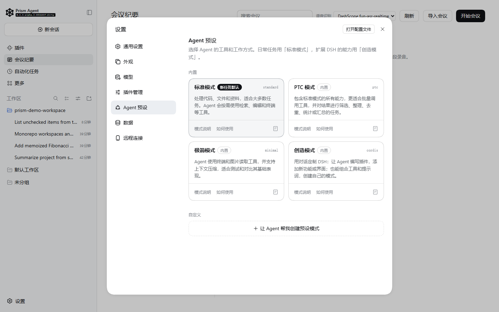
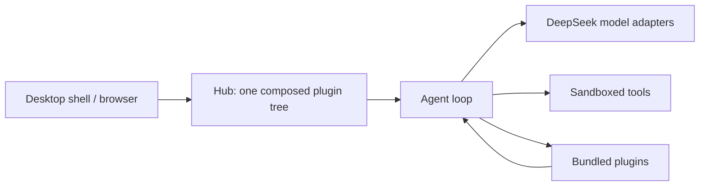

# Prism Agent

[English](README.md) | 中文

<p align="center">
  
</p>

<p align="center">
  <a href="https://github.com/deepseek-ai/deepseek-harness"></a>
  <a href="LICENSE"></a>
  <a href="https://nodejs.org"></a>
  <a href="https://github.com/laochenfei233/prism-agent/releases"></a>
</p>

**Prism Agent** 是 [DeepSeek Harness](https://github.com/deepseek-ai/deepseek-harness)（`dsh`）的开箱即用发行版——这是一套构建于 [Cordis](https://github.com/cordiverse/cordis) 之上、「一切皆插件」的智能体框架：框架内核仍是上游的，而 Prism 把它做成了成品——原生桌面壳、一组预装并即插即用的插件、以及与机器上任何其他 harness 构建相互隔离的安装身份。

<p align="center">
  
  
</p>

## 为什么选择 Prism Agent

- **首次启动即可用。** 安装包自带 Node 运行时、完整 Web UI 和十一个插件——会话导入、迁移导出、备份、记忆、会议、聊天机器人、guardrails 等——第一轮对话只需要一个 API key，其余都已就位。
- **回到桌面更快。** 桌面壳会记录自己拉起的 hub，下次启动直接接管，跳过约 4.1 秒的完整启动；启动解析器改为每个搜索目录只列一次目录，不再逐路径探测（打包运行时实测冷启动：4269 ms → 3903 ms）。
- **更多任务能真正跑完。** 长对话保持健康：过期的工具结果在压缩前被清理，连续失败会交给一次性评判并给模型注入提醒而不是原地卡死，可溯源的持久记忆跨会话携带已验证的事实，长时委派暴露作业控制（`job_list` / `job_kill`），还有定时跟进。
- **本地优先的桌面体验。** Tauri 2 外壳：托盘常驻、单实例启动、崩溃自动拉起、从 GitHub Releases 应用内更新、文件夹拖入，以及一条回环会话代理——端口变化也能保住登录态。
- **隔离即设计。** `prism` 命令、`prism-agent` 包名、`~/.prism` 数据根、私有的默认端口、专属的应用 bundle id——官方 `dsh`、其他 fork 或另一份 Prism 都能与它同机共存、互不干扰。

<a id="run"></a>

## 快速开始

### 桌面应用

1. 从 [GitHub Releases](https://github.com/laochenfei233/prism-agent/releases) 下载对应平台的安装包：Windows NSIS 安装器，或 macOS dmg（未签名——Release 说明中写了如何在系统设置里放行）。
2. 启动 Prism Agent，打开「模型」设置页，填入你的 DeepSeek API key。
3. 开始对话——智能体在本机运行，终端、文件、网络工具开箱即用。

窗口关闭后壳会继续保留 hub 服务（托盘常驻），服务崩溃时自动重启。

<a id="run-from-source"></a>

### 从源码运行 Web UI

前置要求：Node.js ≥ 24.9 与 pnpm ≥ 11。

```sh
git clone https://github.com/laochenfei233/prism-agent.git
cd prism-agent
pnpm install
pnpm run build
pnpm dsh web
```

<!-- PRISM-DIVERGENCE: replay list in docs/compose/spec/fork-upstream-divergence.md (S2), area A8. Upstream's CLI is `npx @deepseek-ai/dsh`; this fork installs its own `prism-agent` package so the two never collide on npm or `~/.dsh`. -->
这会在 `http://127.0.0.1:3080` 启动 Web UI 并用默认浏览器打开；传 `--no-open` 可以只启动服务。`pnpm dsh` 是源码方式运行 CLI——安装产品的命令是 `prism`，且本 fork 不发布 npm 包，上游的 `npx @deepseek-ai/dsh` 用法在这里不适用。

## 安全须知

运行本项目前，请阅读[安全说明](SAFETY.zh.md)。

## 开箱即用

| 能力 | 你得到什么 |
| --- | --- |
| 会话导入 | 把十一个编码智能体的现有对话导入会话列表：Claude Code、Codex、Grok、DeepSeek Harness、MiMo Code、OpenCode、OpenClaw、Hermes、Pi、Gemini CLI、ZCode。 |
| 导出、迁移、备份 | 把项目（目录 + 会话 + 媒体）和设置导出为自描述归档并可导入还原；定时备份到 WebDAV、SMB 或 S3。 |
| 溯源记忆 | 持久、可审计的记忆：替代链、证据指纹、`/memory verify` · `compare` · `maintain`，以及模型辅助蒸馏。 |
| 会议与语音 | 会议页转写与纪要；本地 SenseVoice 与在线识别器（MiMo、DashScope 及九种 HTTP 线形态），长音频自动分段转写。 |
| 本地模型 | 在「模型」页运行自己机器上的本地模型。 |
| 远程访问与机器人 | Pocket 手机页外加九个聊天渠道（Telegram、Discord、Slack、飞书、钉钉、QQ、企业微信、微信、WhatsApp），配对码绑定与审批转发。 |
| 任务可靠性 | guardrails 做上下文卫生与卡会话提醒；委派子智能体的作业控制；定时跟进。 |
| 日常整理 | 空闲会话按计划自动归档并可在设置中恢复；「关于」页承载应用内更新。 |
| 桌面宠物桥 | HachimoDock 可以列出 Prism 会话、打开并引导运行中的智能体。 |

## 界面速览

| 轨迹视图——每一轮、每次工具调用与耗时都在一条可审计的时间线上 | 深色模式——完整 UI，展示同一会话 |
| --- | --- |
|  |  |

| 自动化任务——一键模板的定时任务 | 插件——内置与实验性插件卡片 |
| --- | --- |
|  |  |

| 模型——提供方、语音识别与本地模型在同一页 | Agent 预设——标准、PTC、极简、创造四种工作模式 |
| --- | --- |
|  |  |

## 工作原理

Prism 每个 harness home 启动一个 hub：一棵在启动时由有序 bundle 和补丁层组合出来的插件树，与上游 `dsh` 完全一致。其中的 agent loop 跑完整个 turn 生命周期——组装提示词分段与工具 schema、从模型流式获取回复、执行工具、把每一条模型可见的事实写入持久会话日志——而预装插件以普通事件监听器的身份挂进这条 loop，这就是它们既能开箱预装、又能通过配置随时打补丁或移除的原因。



桌面壳拉起或接管这个 hub，浏览器 UI 通过 RPC 和流与它通信，插件既观察 loop（guardrails、记忆、进度）也引导它（机器人 follow-up、卡死提醒、定时提示）。完整的架构、事件域与扩展点见 [docs/architecture.zh.md](docs/architecture.zh.md)。

## 配置

每个设置页写入的都是经过校验的配置行，生成的[配置目录](docs/config-catalog.zh.md)收录了全部条目；组合层面的控制——bundle、补丁、树外插件——仍按[架构指南](docs/architecture.zh.md)所述留在 YAML 中。

## 面向开发者

- **目录结构。** 每个能力都是 `packages/<group>/<pkg>` 下的工作区包，随发行附带的扩展位于 `plugins/`；[包索引](packages/README.zh.md)给出了分组说明。
- **开发循环。** `pnpm run dev:web` 一条命令完成构建、启动和客户端 bundle 的随改随建；完整命令表见[开发指南](docs/development.zh.md)，智能体入口是 [AGENTS.md](AGENTS.md)。
- **检查。** `pnpm run test`、`pnpm run test:coverage`（逐文件 100% 覆盖率门禁）、`pnpm run typecheck` 与 `pnpm run lint`。
- **上游同步。** 本 fork 以基线导入的方式接上游而非合并：每处分歧点都带 `PRISM-DIVERGENCE` 标记，汇总在 [docs/compose/spec/fork-upstream-divergence.zh.md](docs/compose/spec/fork-upstream-divergence.zh.md)；每次 resync 通过记录的锚点 tag 重放上游增量。

## 致谢

Prism Agent 构建于 [DeepSeek Harness](https://github.com/deepseek-ai/deepseek-harness) 之上——[DeepSeek AI](https://deepseek.com) 的开源 agent harness；框架设计见论文 [_A Programming Paradigm for Spatiotemporal Composability_](https://arxiv.org/abs/2608.25512)。上游文档在 [deepseek-harness.github.io](https://deepseek-harness.github.io/deepseek-harness/)，上游社区入口（Discussions、Discord、`dsh-plugin` topic）见[上游 README](https://github.com/deepseek-ai/deepseek-harness#community-and-support)。

## 引用

```bibtex
@misc{deepseek-harness2026,
  title={DeepSeek Harness: Everything is a Plugin},
  author={DeepSeek-AI},
  year={2026},
  publisher={GitHub},
  howpublished={\url{https://github.com/deepseek-ai/deepseek-harness}},
}
```

## 许可证

[MIT](LICENSE) —— 第三方依赖及其许可披露于 [THIRD_PARTY_NOTICES.md](THIRD_PARTY_NOTICES.md)。
