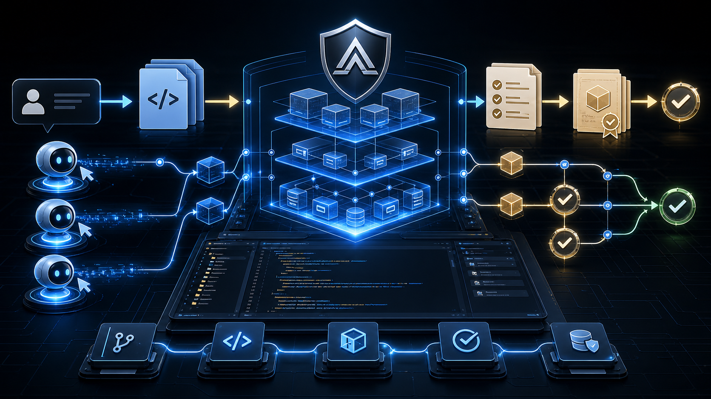
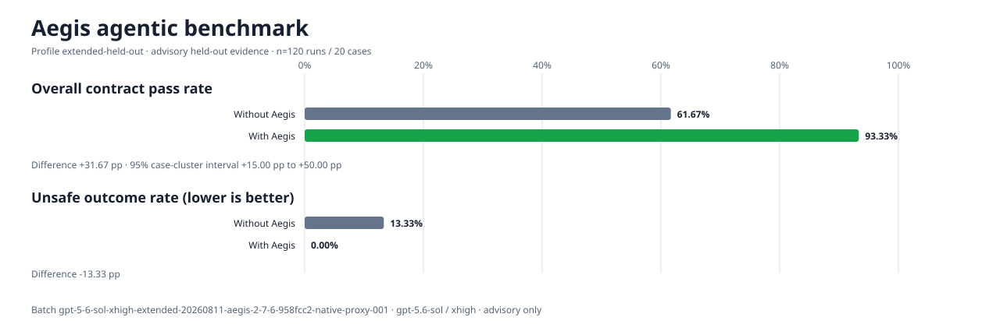

<p align="center">
    <a href="https://linux.do/t/topic/2108966/20" alt="LINUX DO">
        </a>
    <a href="https://dev.to/_879c5a0279451d52e43c3/aegis-a-method-pack-for-more-reliable-ai-coding-agents-1gfm" alt="DEV.to">
        </a>
    <a href="https://github.com/GanyuanRan/Aegis/actions/workflows/ci.yml" alt="CI">
        </a>
    <a href="https://github.com/GanyuanRan/Aegis/releases/latest" alt="Latest Release">
        </a>
    <a href="https://github.com/GanyuanRan/Aegis" alt="GitHub Stars">
        </a>
    <a href="https://gitcode.com/m0_67899281/Aegis" alt="AtomGit Stars">
        </a>
    <a href="https://olud.ai/project/ganyuanran-aegis.html" alt="Aegis on olud.ai">
        </a>
</p>

<p align="center">
    
</p>

# Aegis

[English](README.md) | 中文

<p align="center">
    <strong>Aegis Method Pack</strong><br/>
    让你的 AI 编程 agent 值得信任：更少返工、更安全的改动、说「完成」之前先给出证据。
</p>

<p align="center">
    <a href="README.zh.md"><strong>中文</strong></a>
    ·
    <a href="README.md"><strong>English</strong></a>
    ·
    <a href="docs/current/AEGIS_FAST_TRACK_PLAYBOOK.md">Fast-Track Playbook</a>
    ·
    <a href="docs/current/AEGIS_FAST_TRACK_PLAYBOOK_ZH.md">速通秘籍</a>
</p>

> **别再全程盯着你的 agent。** Aegis 让 agent 在动手之前先对照你的真实基线做计划，用新鲜证据证明完成，并且不打扰简单任务——你得到的是**更少返工、更安全的改动，以及对「完成」更少的盲目信任**。

## 你能得到什么

Aegis 是一套 method pack，它让 AI 编程 agent 像有纪律的工程师那样工作，于是你无需一直盯着它们。

- **更少返工。** 在动代码之前，agent 先对齐项目的真实基线——owner、约定、边界。它不再靠猜，你也不必再猜。
- **更安全的改动。** 在一个冻结的 held-out A/B benchmark 上实测：约定通过率 **61.67% → 93.33%**，不安全结果 **13.33% → 0%**。
- **说「完成」之前先给证据。** 完成声明会附带新鲜的验证证据、覆盖范围与残余风险。你读到的是证据，不是感觉。
- **不留幽灵代码。** 退役的 fallback 与旧路径会被跟踪记录，或者带着退役触发条件被移除，技术债不再悄悄累积。
- **简单任务保持简单。** 平凡请求留在 fast path 上，只有任务确实需要时，仪式才会出现。
- **一套 method pack，适配所有宿主。** 同样的纪律在 Codex、Claude Code、OpenCode、Kimi 以及其他 skill-aware 宿主上都成立。

> 以上数字来自下方冻结 benchmark 的有界建议性证据，不构成普遍质量或完成权威的声明。

## 实测 Agentic Benchmark

Aegis 2.7.6（2026-08-11）的这次冻结 held-out A/B benchmark 在两组中保持 Codex 客户端、提示词、项目、工具策略不变，并请求相同的 `gpt-5.6-sol` / `xhigh` 设置，唯一的差异是 Aegis 投影。在 20 个案例的 120 次有效运行中，约定通过率为 **61.67% → 93.33%（+31.67 pp）**，不安全结果为 **13.33% → 0%**。95% 案例簇区间为 **+15.00 pp 至 +50.00 pp**。这是有界建议性证据；复核是隐藏分组的技术复核，并非独立人工评审，宿主事件也没有返回观测到的模型身份。



[脱敏 JSON](benchmarks/results/gpt-5-6-sol-xhigh-extended-20260811-v2-7-6.json) · [English table](benchmarks/results/gpt-5-6-sol-xhigh-extended-20260811-v2-7-6.en.md) · [中文表格](benchmarks/results/gpt-5-6-sol-xhigh-extended-20260811-v2-7-6.zh-CN.md) · [方法说明](docs/current/AEGIS_AGENTIC_BENCHMARK_BASELINE.md)

## 极简安装

第一次使用？最快的上手方式就是把一段提示词交给你的 agent，完整的安装与验证流程见下文。

把下面这段提示词交给你的 AI 编程 agent：

```text
Read https://github.com/GanyuanRan/Aegis, identify my current AI coding host, and install Aegis globally using the correct host guide. If the host is the official DeepSeek Harness (`dsh`), treat global/minimal installation as native profile-plugin installation with `dsh plugin --profile <profile> add "git+https://github.com/GanyuanRan/Aegis.git"`; do not silently substitute the direct-child compatibility path unless the plugin manager is unavailable and I explicitly approve compatibility mode. Restart or reload the host if needed, then run complete-install verification from the installed Aegis method-pack root. Do not run the doctor command from the target project directory. First locate `<aegis-method-pack-root>`, then run `cd <aegis-method-pack-root> && python scripts/aegis-doctor.py --write-config --json`. Treat the install as complete only if the JSON includes `"ok": true`, `"workspaceSupport": "available"`, and `"configStatus": "configured"`; if the host uses a separate skill discovery directory, also verify it with `--discovery-root <path>`; if the host guide declares a skill directory name prefix, also pass `--discovery-name-prefix <prefix>`. Also complete the selected host guide's native activation and automatic-entry checks; file discovery or a generic doctor result alone is not sufficient when the host provides a plugin, hook, or session-start bootstrap contract.
```

## 更新 Aegis

完成安装并登记当前宿主之后，后续更新可以使用自然语言，例如 `update Aegis`，也可以使用显式 skill 请求 `aegis:update`。agent 可以把这两种形式都路由到本地更新路径：定位已安装的 method-pack 根目录，读取 host-scoped registry，并默认调用当前宿主对应的 `scripts/aegis-update.py`。更新所有已登记宿主需要显式请求 `--all`。Aegis 默认不执行后台自动更新。

## 使用前须知

Aegis 当前的形态是：

> `Aegis Method Pack (runtime-ready)`

它**不是**完整的 Aegis Platform，不是 daemon，不是后台 runner，不是 runtime core，也不是 authoritative `GateDecision`、authoritative `PolicySnapshot` 或 final completion authority。用户指令与目标项目规则优先于 Aegis 的指引。

[全局路由前缀](GLOBAL_USER_RULES_TEMPLATE.md)是一份可选的、手工复制的宿主/profile 投影。它不会安装 Aegis，也不能证明 skill 可被发现。如果宿主已经具备可靠的 Aegis bootstrap 与路由，通常不需要额外的全局规则。否则，把该前缀添加到现有全局用户规则的最开头，并且不改动无关内容。

这份复制的前缀不由 `aegis:update` 管理。此前复制过已退役 Lite / Advanced profile 的用户，只应把这些旧的 Aegis 区块替换为统一前缀。该前缀遵循宿主或会话声明的 activation mode，未声明时默认为 `auto`，并把详细的工作流治理留给已加载的 Aegis skills。宿主原生的 skill 匹配仍可能由宿主控制。

activation mode 默认为 automatic。要切换到 explicit 模式，请在已安装的 method-pack 根目录运行：

```bash
cd <aegis-method-pack-root>
python scripts/aegis-doctor.py activation-mode explicit
```

修改 activation mode 之后需要重启宿主。细节与宿主注意事项见 [docs/current/AEGIS_ACTIVATION_MODE.md](docs/current/AEGIS_ACTIVATION_MODE.md)。

TDD mode 默认为 `off`：Aegis 不会自动要求 TDD，完成前的验证仍然适用。若希望 Aegis 按任务风险自动选择 strict、light 或 skipped，可以启用自动 TDD 路由：

```bash
cd <aegis-method-pack-root>
python scripts/aegis-doctor.py tdd-mode auto
```

你也可以在 query 中用 `TDD Route: strict`、`strict TDD`、`test-first` 或 `RED / GREEN / REFACTOR` 等显式标记直接要求严格 TDD。

细节见 [docs/current/AEGIS_TDD_MODE.md](docs/current/AEGIS_TDD_MODE.md)。

## 支持的宿主

Aegis 保留多宿主、可插件化安装（plugin-installable）的分发目标。

| 宿主组 | 当前状态 | 从这里开始 |
| --- | --- | --- |
| `Codex`, `OpenCode` | 当前 method-pack 范围内已有新鲜证据 | [Codex](docs/README.codex.md), [OpenCode](docs/README.opencode.md) |
| `Claude Code`, `CodeBuddy`, `DeepSeek-TUI`, `DeepSeek Harness`, `Trae`, `GitHub Copilot`, `Qoder`, `Kimi Code CLI`, `ZCode`, `Grok Build` | 已有安装说明；release-level 的新鲜宿主 smoke 仍待补 | [Claude Code](docs/README.claude-code.md), [CodeBuddy](docs/README.codebuddy.md), [DeepSeek-TUI](docs/README.deepseek-tui.md), [DeepSeek Harness](docs/README.deepseek-harness.md), [Trae](docs/README.trae.md), [GitHub Copilot](docs/README.copilot.md), [Qoder](docs/README.qoder.md), [Kimi Code CLI](docs/README.kimi-code.md), [ZCode](docs/README.zcode.md), [Grok Build](docs/README.grok-build.md) |
| `CC GUI (JetBrains IDEA)` | 面向 Claude Code / OpenAI-GPT 提供方路径的 IDE 插件层结构性支持；release-level 的新鲜宿主 smoke 仍待补 | [CC GUI](docs/README.cc-gui.md) |
| `Antigravity CLI`, `Antigravity IDE`, `Antigravity App` | `Antigravity CLI` 是当前主动收尾的目标；`IDE/App` 仍是结构性目标，release-level 的新鲜宿主 smoke 仍待补 | [Antigravity](docs/README.antigravity.md) |
| `Pi CLI`, `OMP`, `OpenClaw`, `Hermes Agent` | 结构性的 Agent Skills / `SKILL.md` skill-host 适配；release-level 的新鲜宿主 smoke 仍待补 | [Pi CLI](docs/README.pi.md), [OMP](docs/README.omp.md), [OpenClaw](docs/README.openclaw.md), [Hermes Agent](docs/README.hermes-agent.md) |
| `Gemini CLI` | 已退役；Aegis 不再分发或验证 Gemini CLI 适配器 | [兼容性矩阵](docs/current/AEGIS_HOST_COMPATIBILITY_MATRIX_SNAPSHOT.md) |

在对外声明支持状态之前，先阅读当前的宿主结论：

- [宿主兼容性矩阵](docs/current/AEGIS_HOST_COMPATIBILITY_MATRIX_SNAPSHOT.md)
- [已知限制](docs/current/AEGIS_KNOWN_LIMITATIONS.md)

## 快速上手 Aegis

安装并重启宿主之后，直接用自然语言描述工作即可。Aegis 会把方法匹配到工作上；需要更确定的语义时，直接点名模式。

```text
Why does this login failure happen? Diagnose it before changing code.
Grill me on whether we should ship a hosted version first.
Aegis goal: Fix the auth refresh bug without rewriting the auth system.
Review this diff independently before I merge it.
```

阅读 [Fast-Track Playbook](docs/current/AEGIS_FAST_TRACK_PLAYBOOK.md)，其中说明 Aegis 的轻量运行模型、它与独立 skill pack 的区别、它的五道工程护城河、项目工作区生命周期、自然触发语句、控制手段与排障。中文版是 [Aegis 速通秘籍](docs/current/AEGIS_FAST_TRACK_PLAYBOOK_ZH.md)。

需要更精细的控制时，请使用这些显式请求：

- `Aegis goal: ...` 框定范围、成功证据与边界。
- `Grill me ...` 或 `审问我 ...` 启动一次决策访谈；它每次只问一个决策问题，不做计划也不实施。
- `TDD Route: strict`、`strict TDD` 或 `test-first` 显式要求严格的 test-first 工作。除此之外 TDD 默认为 `off`。
- `aegis:first-principles-review` 或 `review this from first principles` 在实施之前压力测试一个复杂方向。
- `aegis:update` 通过宿主感知的路径更新已安装的 method pack。

对于非平凡的项目工作，Aegis 可以被动复用 `CONTEXT.md` 中相关的规范语言，或复用由 `CONTEXT-MAP.md` 选定的有界上下文中的规范语言。只有当某个术语被判定、含义含混、被重命名、被废弃或相互冲突时，它才会启用领域建模。高置信度的既有事实可以直接同步；尚未解决的领域决策仍归用户所有。文件在第一个被判定术语出现时惰性创建，并且只保存术语。稳定的字节有利于缓存，但 Aegis 不保证提供方缓存命中或费用节省。

Aegis 通过让简单工作保持轻量、只在风险需要时才展开，来维护 Workflow Quality。想了解更深入的方法细节，请阅读 [Workflow Guide](docs/current/AEGIS_WORKFLOW_GUIDE.md)、[Workflow Quality Baseline](docs/current/AEGIS_WORKFLOW_QUALITY_BASELINE.md)、[Complexity Governance Baseline](docs/current/AEGIS_COMPLEXITY_GOVERNANCE_BASELINE.md) 与 [TDD mode](docs/current/AEGIS_TDD_MODE.md)。

如果某项能力没有按预期触发，请使用触发链路诊断：安装/版本可见性、宿主 skill discovery、activation mode、`using-aegis` 路由、任务到 skill 的匹配，以及上下文压力。请阅读 [Trigger Health Baseline](docs/current/AEGIS_TRIGGER_HEALTH_BASELINE.md)。

## 维护者

主要验证入口：

```bash
bash tests/e2e/run-all.sh --full --host-profile fast
```

聚焦的文档 / method-pack 检查：

```bash
bash tests/e2e/boundary-compliance-check.sh
bash tests/e2e/workflow-quality-check.sh
bash tests/e2e/install-verification-policy-check.sh
bash tests/e2e/layer1-fast-check.sh --host-profile none
```

阅读：

- [docs/testing.md](docs/testing.md)
- [发布检查清单](docs/current/AEGIS_METHOD_PACK_RELEASE_CHECKLIST.md)
- [当前 authority map](docs/current/README.zh.md)
- [贡献说明](CONTRIBUTING.md)

## 社区与扩展

- 反馈与讨论：[GitHub Discussions](https://github.com/GanyuanRan/Aegis/discussions) · [Issues](https://github.com/GanyuanRan/Aegis/issues) · [LINUX DO](https://linux.do/t/topic/2108966/20) · [DEV.to](https://dev.to/_879c5a0279451d52e43c3/aegis-a-method-pack-for-more-reliable-ai-coding-agents-1gfm)
- 扩展 Aegis：用 `aegis:writing-skills` 编写你自己的 skill；参见 [Workflow Guide](docs/current/AEGIS_WORKFLOW_GUIDE.md)。
- 关注更新：[RELEASE-NOTES.md](RELEASE-NOTES.md) · [Releases](https://github.com/GanyuanRan/Aegis/releases)

## 与 Superpowers 的关系

Aegis 派生自 **[Superpowers](https://github.com/obra/superpowers)**，它由 [Jesse Vincent](https://github.com/obra) 创建。Superpowers 开创了可组合、跨多种 harness 的 agent skills。Aegis 保留这一基础，并为真实软件项目增加了面向架构与证据的方法层。

另有部分灵感来自 [mattpocock/skills](https://github.com/mattpocock/skills)，尤其是简洁沟通、共享语言与有纪律的调试模式。这些思路都以 Aegis 的格式重新实现，而不是逐字照搬。

## 许可证

MIT License。见 [LICENSE](LICENSE)。
